<div align="center">

# AMY Studio



**Ideas into digital experiences.**

The official website of **AMY Studio**, a creative technology team building thoughtful digital products — from websites and apps to games and desktop software.

**نحوّل فكرتك إلى منتج رقمي يستحق أن يُرى.**

</div>

---

## About the project

AMY Studio is a bilingual, responsive website introducing the team's services, highlighting selected work, and helping potential clients share their project ideas through WhatsApp.

The site focuses on clear content, a distinctive purple visual identity, and an accessible experience across desktop and mobile devices.

## Features

- **Bilingual interface:** Arabic (RTL) and English (LTR), powered by `next-intl`.
- **Light and dark themes** with a consistent design system.
- **Responsive layout** for mobile, tablet, and desktop screens.
- **Services showcase** covering web development, databases, mobile apps, games, and desktop software.
- **Featured project** with a preview and external project link.
- **About section** introducing AMY Studio and its approach.
- **FAQ section** with expandable answers.
- **WhatsApp contact composer** that prepares a message based on the selected project type and optional description.
- **Motion and micro-interactions** with reduced-motion support.

## Tech stack

| Category             | Technology                       |
| -------------------- | -------------------------------- |
| Framework            | Next.js 16 (App Router)          |
| UI                   | React 19, TypeScript             |
| Styling              | Tailwind CSS v4                  |
| Internationalization | next-intl                        |
| Motion               | Motion for React, CSS animations |
| Icons                | Lucide React                     |
| Code quality         | ESLint, TypeScript               |
| CI                   | GitHub Actions                   |

## Project structure

```text
amy-team-website/
├── .github/
│   └── workflows/
│       └── ci.yml
├── messages/                 # Arabic and English translations
├── public/                   # Static images, fonts and assets
├── src/
│   ├── app/
│   │   ├── [locale]/         # Localized app layout and homepage
│   │   └── globals.css       # Global styles and design tokens
│   ├── components/
│   │   ├── layout/           # Header and footer
│   │   ├── providers/        # Shared UI providers
│   │   ├── sections/         # Hero, services, projects, about, FAQ, contact
│   │   └── ui/               # Reusable interface components
│   └── i18n/                 # Locale routing and configuration
├── tests/
└── package.json
```

## Languages

The website supports:

- `ar` — Arabic (default, right-to-left)
- `en` — English (left-to-right)

Locale-prefixed routes are used (`/ar` and `/en`). Translated content is maintained in the `messages/` directory.

## Design and customization

- **Brand colors and theme tokens:** `src/app/globals.css`
- **Homepage sections:** `src/components/sections/`
- **Shared navigation and footer:** `src/components/layout/`
- **Translations:** `messages/ar.json` and `messages/en.json`

Keep both languages updated when making content changes. Review desktop and mobile layouts as well as light and dark themes before merging UI changes.

## Continuous integration

GitHub Actions runs automatically on pushes and pull requests targeting `main`. The current CI workflow performs:

1. Dependency installation with `npm ci`
2. ESLint checks
3. Next.js type generation
4. TypeScript type checking
5. Production build

The test suite can also be run locally using `npm run test`.

<div align="center">

**Built with care by AMY Studio.**

</div>
